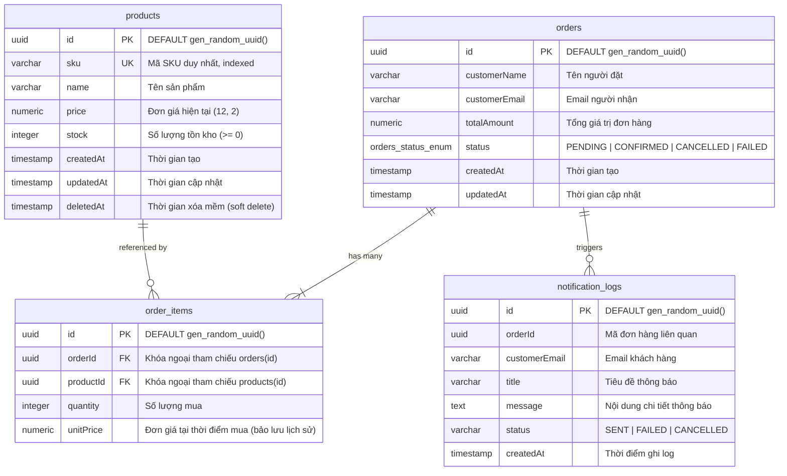
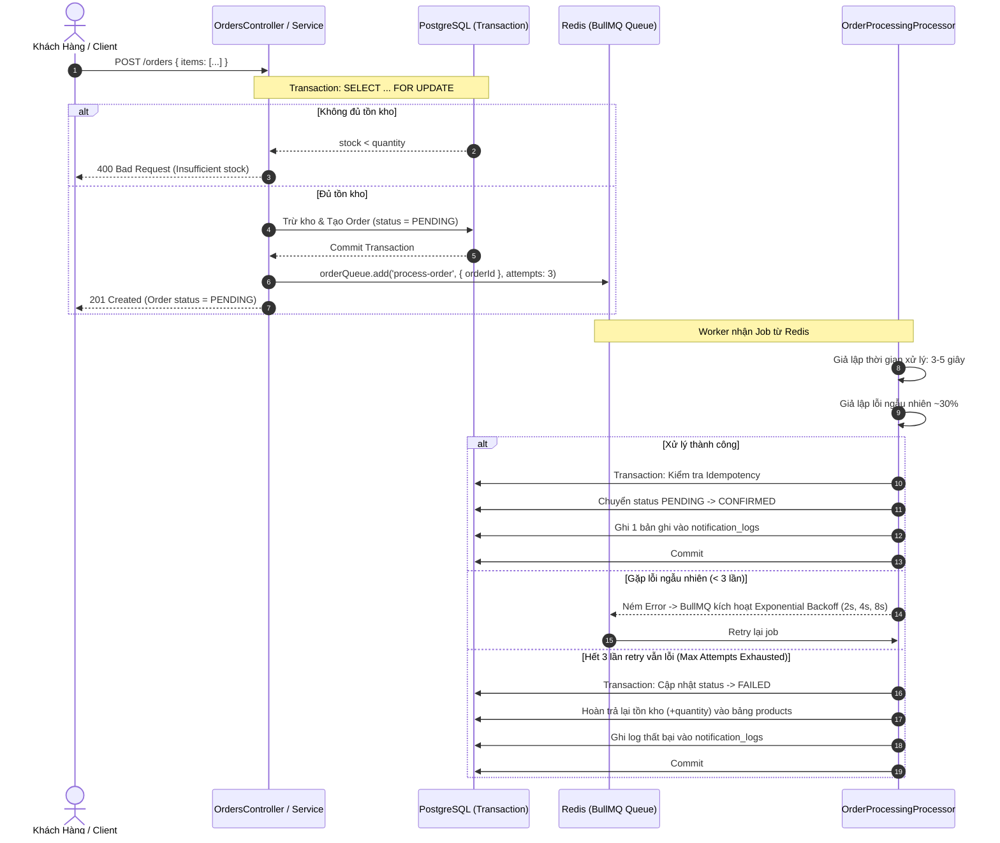
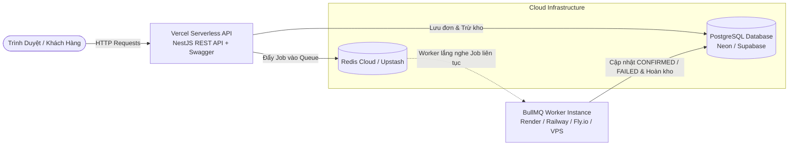

# HEMIDI - Mini Order Management System (Backend Assessment)
> **Vị trí ứng tuyển:** Fresher NodeJS Developer  
> **Ứng viên:** Lê Vĩnh Quang  
> **Tech Stack:** NestJS · PostgreSQL · TypeORM (Migration) · BullMQ · Redis · Swagger · Jest  

---

## 🌟 Giới Thiệu Tổng Quan

Hệ thống **Mini Order Management** được xây dựng với mục tiêu quản lý sản phẩm, tồn kho và xử lý đơn hàng bất đồng bộ ở chế độ nền (asynchronous background queue) mà không bắt người dùng phải chờ đợi.

Hệ thống giải quyết triệt để bài toán **chống bán vượt tồn kho (Overselling / Race Condition)** khi hàng loạt khách hàng cùng đặt món hàng cuối cùng ở cùng một thời điểm, kết hợp cơ chế xử lý nền chịu lỗi với **BullMQ**, retry tự động kèm exponential backoff, và tính lũy đễnh (**Idempotency**).

---

## 🚀 Tính Năng Chính Hoàn Thành

| Yêu Cầu Đề Bài | Trạng Thái | Mô Tả Kỹ Thuật |
| :--- | :---: | :--- |
| **1. Quản lý Sản phẩm (Products)** | ✅ Hoàn thành | `POST/GET /products`, `GET/PATCH/DELETE /products/:id`. Validate DTO, phân trang (`page`, `limit`), tìm kiếm tên (case-insensitive `ILIKE`), lọc khoảng giá (`minPrice`, `maxPrice`). Soft delete (`deletedAt`). |
| **2. Quản lý Đơn hàng (Orders)** | ✅ Hoàn thành | `POST /orders`, `GET /orders`, `GET /orders/:id`, `PATCH /orders/:id/cancel`. Thực thi trong 1 Database Transaction, lưu giá tại thời điểm mua (`unitPrice`). |
| **3. Chống Bán Vượt Tồn Kho** | ✅ Xuất sắc | Sử dụng **PostgreSQL Pessimistic Locking (`SELECT ... FOR UPDATE`)**, sắp xếp khóa ID tránh Deadlock, đã có script test 10 requests đồng thời chỉ 1 đơn thành công. |
| **4. Xử lý nền BullMQ (`order-processing`)** | ✅ Hoàn thành | Giả lập xử lý 3–5 giây, chuyển `PENDING` ➔ `CONFIRMED`, ghi nhật ký `notification_logs`. |
| **5. Retry & Chịu Lỗi (~30% lỗi ngẫu nhiên)** | ✅ Hoàn thành | Cấu hình retry 3 lần, backoff exponential. Khi hết 3 lần thử thất bại ➔ chuyển `FAILED` và **tự động hoàn kho**. |
| **6. Idempotency (Chống xử lý trùng)** | ✅ Hoàn thành | Job retry hoặc gửi lặp không bị trừ/hoàn kho hay tạo log lần 2 nhờ kiểm tra trạng thái đơn hàng và Transaction row-lock. |
| **7. Tra cứu Job BullMQ** | ✅ Hoàn thành | `GET /orders/:id/jobs` trả về chi tiết trạng thái job (`state`, `attemptsMade`, `failedReason`, timestamps). |
| **8. Điểm cộng: Tự hủy đơn quá hạn** | ✅ Hoàn thành | Repeatable job BullMQ chạy mỗi 5 phút (`*/5 * * * *`), tự động hủy các đơn `PENDING` quá 30 phút và hoàn lại tồn kho. |
| **9. Unit Tests (OrdersService)** | ✅ Hoàn thành | Tối thiểu 3 test bắt buộc + 2 test mở rộng (tổng 10 unit test pass 100%). |
| **10. Frontend Web Dashboard (Điểm cộng)** | ✅ Hoàn thành | Giao diện trực quan tại `/` hỗ trợ quản lý sản phẩm, đặt hàng, **1-Click Concurrency Race Simulator**, theo dõi job BullMQ và nhật ký thông báo theo thời gian thực. |

---

## 🏗️ Cấu Trúc Mã Nguồn (MVC & Clean Modular Architecture)

Dự án tuân thủ nghiêm ngặt mô hình Controller – Service – Repository của NestJS:

```
src/
├── common/
│   ├── dto/
│   │   └── pagination.dto.ts             # DTO phân trang chuẩn hóa
│   ├── filters/
│   │   └── http-exception.filter.ts      # Bộ lọc ngoại lệ toàn cục định dạng lỗi thống nhất
│   └── utils/
│       └── numeric.transformer.ts        # Transformer chuyển đổi decimal PostgreSQL -> number
├── database/
│   ├── data-source.ts                    # Cấu hình TypeORM DataSource CLI
│   ├── migrations/
│   │   └── 1710000000000-InitialSchema.ts# File Migration tạo bảng & enum
│   └── seeds/
│       └── seed.ts                       # Script seed dữ liệu mẫu
├── modules/
│   ├── products/                         # Module quản lý sản phẩm & tồn kho
│   │   ├── dto/                          # DTO: Create, Update, Query (validate class-validator)
│   │   ├── entities/product.entity.ts    # Entity Product (soft delete, unique SKU)
│   │   ├── products.controller.ts        # Products Controller + Swagger API Docs
│   │   ├── products.service.ts           # Business logic sản phẩm
│   │   ├── products.service.spec.ts      # Unit tests ProductsService
│   │   └── products.module.ts
│   ├── orders/                           # Module quản lý đơn hàng
│   │   ├── dto/                          # CreateOrderDto, QueryOrderDto
│   │   ├── entities/
│   │   │   ├── order.entity.ts           # Order Entity (Status: PENDING, CONFIRMED, CANCELLED, FAILED)
│   │   │   └── order-item.entity.ts      # OrderItem Entity (Lưu unitPrice thời điểm mua)
│   │   ├── orders.controller.ts          # Orders Controller + Swagger
│   │   ├── orders.service.ts             # Pessimistic Locking, Transaction, Hoàn kho
│   │   ├── orders.service.spec.ts        # 5 Unit tests trọng yếu cho OrdersService
│   │   └── orders.module.ts
│   ├── order-processing/                 # Module xử lý nền với BullMQ
│   │   ├── order-processing.processor.ts # Worker xử lý job, retry backoff, hoàn kho khi thất bại
│   │   ├── order-processing.service.ts   # Quản lý hàng đợi, đẩy job, tra cứu job, repeatable cron
│   │   └── order-processing.module.ts
│   └── notifications/                    # Module ghi nhận log thông báo
│       ├── entities/notification-log.entity.ts
│       ├── notifications.controller.ts
│       ├── notifications.service.ts
│       └── notifications.module.ts
├── public/                               # Frontend Web Dashboard (HTML5/CSS3/Vanilla JS)
│   ├── index.html
│   ├── style.css
│   └── app.js
├── app.module.ts
└── main.ts                               # Khởi chạy NestJS, Swagger docs (/api/docs), Static UI
scripts/
└── test-concurrency.ts                   # Script tự động bắn 10 requests đồng thời kiểm chứng race condition
```

---

## 🗄️ Thiết Kế Cơ Sở Dữ Liệu (Database Schema)

Hệ thống sử dụng PostgreSQL với **TypeORM Migration** (`synchronize: false` tuyệt đối).



---

## 🛡️ Cơ Chế Chống Bán Vượt Tồn Kho (Overselling Prevention)

### 1. Vấn đề Race Condition
Khi 2 hoặc nhiều khách hàng cùng bấm đặt mua món hàng cuối cùng (`stock = 1`) tại cùng một mili-giây, nếu hệ thống chỉ đọc tồn kho bình thường (`SELECT stock FROM products`):
- Cả 2 luồng đều đọc thấy `stock = 1`.
- Cả 2 luồng đều kiểm tra điều kiện `stock >= 1` hợp lệ.
- Cả 2 luồng cùng thực hiện trừ kho: `stock = stock - 1`.
- **Hậu quả:** Tồn kho bị âm (`stock = -1`), 2 đơn hàng được tạo cho 1 món hàng vật lý duy nhất.

### 2. Giải Pháp Triệt Để: Pessimistic Locking (`SELECT ... FOR UPDATE`)
Chúng tôi giải quyết triệt để vấn đề này tại tầng cơ sở dữ liệu PostgreSQL trong 1 Transaction duy nhất:

```typescript
// 1. Sắp xếp danh sách productId trước khi duyệt để chống Deadlock
const sortedItems = [...items].sort((a, b) => a.productId.localeCompare(b.productId));

// 2. Khóa dòng dữ liệu sản phẩm ở mức Row-Level Lock
const product = await queryRunner.manager.findOne(Product, {
  where: { id: item.productId },
  lock: { mode: 'pessimistic_write' }, // Phát sinh câu lệnh: SELECT ... FOR UPDATE
});

// 3. Kiểm tra tồn kho sau khi đã sở hữu khóa độc quyền
if (product.stock < item.quantity) {
  throw new BadRequestException(
    `Insufficient stock for product "${product.name}" (SKU: ${product.sku}). Requested: ${item.quantity}, Available: ${product.stock}`,
  );
}

// 4. Trừ kho và lưu lại trong transaction
product.stock -= item.quantity;
await queryRunner.manager.save(product);
```

#### Tại sao cơ chế này hoạt động hoàn hảo?
- Khi giao dịch A thực thi `SELECT ... FOR UPDATE`, PostgreSQL đặt một khóa ghi độc quyền trên dòng sản phẩm đó.
- Giao dịch B đến đồng thời sẽ bị PostgreSQL chặn (block) và phải chờ giao dịch A commit hoặc rollback.
- Ngay khi giao dịch A commit trừ kho xong (`stock` giảm về `0`), giao dịch B mới được đọc dòng đó. Lúc này B đọc được giá trị `stock = 0`, lập tức ném lỗi `400 Bad Request: Insufficient stock`.
- **Kết quả:** 1 đơn được tạo (201 Created), 1 đơn bị từ chối (400 Bad Request). Tồn kho cuối cùng là 0, không bao giờ bị âm.

---

## ⚡ Luồng Xử Lý Nền Với BullMQ (`order-processing`)



### Tính Idempotent (Chống Xử Lý Trùng)
- Job ID được gán cố định bằng `order.id` khi đưa vào queue, ngăn ngừa việc đẩy trùng job cùng lúc.
- Trong Worker, trước khi cập nhật trạng thái đơn, hệ thống luôn đọc trạng thái hiện tại:
  - Nếu đơn đã là `CONFIRMED`: Bỏ qua, không cập nhật lại, không ghi thêm thông báo.
  - Nếu đơn đã bị khách hủy (`CANCELLED`): Bỏ qua, không chuyển `CONFIRMED`.
  - Nếu đơn đã `FAILED`: Bỏ qua, không hoàn kho lần thứ hai.

---

## 🛠️ Hướng Dẫn Cài Đặt & Chạy Local

### 1. Yêu cầu môi trường
- Node.js >= 18.x (khuyên dùng Node 20+)
- PostgreSQL 14+ và Redis 6+ (hoặc dùng Docker Compose)

### 2. Khởi động PostgreSQL & Redis với Docker
Nếu máy bạn đã có Docker:
```bash
docker-compose up -d
```
Hoặc cấu hình thông tin PostgreSQL & Redis có sẵn trên máy vào file `.env`.

### 3. Cài đặt Dependencies & Cấu hình biến môi trường
```bash
# Clone repo
git clone <link-github-repo>
cd LeVinhQuang_Nodejs

# Cài đặt dependencies
npm install

# Tạo file .env từ file mẫu
cp .env.example .env
```

Nội dung file `.env` chuẩn:
```env
PORT=3000
NODE_ENV=development

# Database Configuration (PostgreSQL)
DB_HOST=127.0.0.1
DB_PORT=5432
DB_USERNAME=postgres
DB_PASSWORD=secret
DB_DATABASE=mini_order_db

# Redis Configuration (BullMQ)
REDIS_HOST=127.0.0.1
REDIS_PORT=6379
REDIS_PASSWORD=
REDIS_TLS=false

# Simulation Settings
SIMULATE_FAILURE_RATE=0.3
ORDER_EXPIRY_MINUTES=30
```

### 4. Chạy Migration & Seed Dữ Liệu
> **Quy định bắt buộc:** TypeORM viết Migration, không dùng `synchronize`.

```bash
# Thực thi Migration để tạo các bảng
npm run migration:run

# Nạp dữ liệu sản phẩm mẫu (bao gồm sản phẩm stock = 1 để test Concurrency)
npm run seed
```

### 5. Khởi động Ứng dụng
```bash
# Chế độ phát triển (Development)
npm run start:dev

# Hoặc Build & chạy Production
npm run build
npm run start:prod
```

Truy cập:
- 🖥️ **Web Dashboard Giao Diện Đầy Đủ:** [http://localhost:3000](http://localhost:3000)
- 📚 **Swagger API Documentation:** [http://localhost:3000/api/docs](http://localhost:3000/api/docs)

---

## 🧪 Kiểm Thử (Testing)

### 1. Chạy Unit Tests với Jest
Đã bao gồm 5 bài test trọng yếu cho `OrdersService` và 4 bài test cho `ProductsService`:
1. Tạo đơn hàng thành công (Trừ kho, tạo đơn PENDING, đẩy job vào queue).
2. Xử lý lỗi khi không đủ tồn kho (Ném `BadRequestException`, rollback transaction, không đẩy job).
3. Hủy đơn hàng và hoàn lại tồn kho (Chuyển sang `CANCELLED`, hoàn trả số lượng vào `products`, lưu log).
4. Ngăn chặn hủy đơn đã hủy (`Order is already cancelled`).
5. Ngăn chặn hủy đơn đã thất bại (`Cannot cancel order that has already failed`).

```bash
npm test
```
*Kết quả:* **10 / 10 test suites PASSED (100% Green).**

### 2. Chạy Concurrency Stress Test Script
Script tự động bắn **10 requests đồng thời trong cùng 1 mili-giây** vào một sản phẩm chỉ có **1 tồn kho duy nhất**:

```bash
npm run test:concurrency
```

**Kết quả thực tế thu được:**
```
================ RESULTS BREAKDOWN ================
✅ Customer #1: SUCCESS (201 Created) -> Order ID: 2d98661b-605d-4e69-bf17-4bed5ee1abff
❌ Customer #2: REJECTED (400 Bad Request) -> Insufficient stock for product ... Requested: 1, Available: 0
❌ Customer #3: REJECTED (400 Bad Request) -> Insufficient stock for product ... Requested: 1, Available: 0
...
❌ Customer #10: REJECTED (400 Bad Request) -> Insufficient stock for product ... Requested: 1, Available: 0

================ SUMMARY ================
Total Requests:         10
Successful (201):       1 (Expected: 1)
Rejected (400):         9 (Expected: 9)
Final Database Stock:   0 (Expected: 0)
=========================================
🏆 VERIFICATION PASSED: Concurrency control and Pessimistic Locking work flawlessly!
Zero overselling detected under high concurrency.
```

---

## 🌐 Chiến Lược Deploy Serverless (Vercel/Netlify) vs BullMQ Worker

### 1. Bản chất kiến trúc Serverless (Vercel / Netlify)
Vercel và Netlify hoạt động theo mô hình **Serverless Functions (AWS Lambda-based)**:
- Vòng đời hàm ngắn ngủi (ephemeral): Container chỉ khởi tạo khi có request HTTP đến và lập tức bị "đóng băng" (freeze) hoặc hủy ngay sau khi trả phản hồi HTTP về cho client.
- Không thể duy trì kết nối Socket / Event Loop liên tục với Redis.
- Do đó, **BullMQ Worker KHÔNG THỂ chạy liên tục trên Vercel/Netlify** vì worker cần một tiến trình nền Node.js chạy thường trực (long-running process) để liên tục poll và lắng nghe các job trong queue.

### 2. Giải Pháp Triển Khai Tối Ưu



1. **Phần Web API + Swagger:** Triển khai lên **Vercel** thông qua file `vercel.json` (đã cấu hình sẵn trong repository) để tận dụng CDN toàn cầu và tự động scale.
2. **Cơ sở dữ liệu & Caching:**
   - Database: **Neon.tech** hoặc **Supabase** (PostgreSQL Serverless miễn phí).
   - Redis: **Upstash** hoặc **Redis Cloud** (Hỗ trợ BullMQ qua kết nối TLS).
3. **Phần Worker (`order-processing`):**
   - Triển khai riêng bằng **Dockerfile** (đã viết sẵn) lên **Render.com (Background Worker)**, **Railway.app**, hoặc **Fly.io**.
   - Cả hai cùng kết nối chung một URL PostgreSQL và Redis.

---

## 📋 Danh Sách API Endpoints (Swagger tại `/api/docs`)

### 1. Products
- `POST /products`: Tạo sản phẩm mới (SKU duy nhất, tên, giá, số lượng tồn kho).
- `GET /products`: Lấy danh sách sản phẩm (hỗ trợ phân trang `page`, `limit`, tìm kiếm `search`, lọc giá `minPrice`, `maxPrice`).
- `GET /products/:id`: Chi tiết sản phẩm.
- `PATCH /products/:id`: Cập nhật thông tin/tồn kho.
- `DELETE /products/:id`: Xóa mềm sản phẩm (`deletedAt`).

### 2. Orders
- `POST /orders`: Đặt hàng trong 1 transaction an toàn, trừ kho, tạo đơn `PENDING`, lưu `unitPrice` lịch sử, đẩy job BullMQ.
- `GET /orders`: Lấy danh sách đơn hàng (phân trang, lọc theo trạng thái: `PENDING`, `CONFIRMED`, `CANCELLED`, `FAILED`).
- `GET /orders/:id`: Lấy chi tiết đơn kèm danh sách món hàng và thông tin sản phẩm.
- `PATCH /orders/:id/cancel`: Hủy đơn hàng và tự động hoàn trả tồn kho (chỉ áp dụng khi đơn ở trạng thái `PENDING` hoặc `CONFIRMED`).
- `GET /orders/:id/jobs`: Tra cứu tiến trình xử lý nền BullMQ của đơn hàng (`state`, `attemptsMade`, `failedReason`).

### 3. Notifications & Audit
- `GET /notifications`: Xem toàn bộ nhật ký thông báo hệ thống được ghi bởi worker.
- `GET /notifications/orders/:orderId`: Xem thông báo theo mã đơn hàng.

---

## 🎯 Phần Tự Đánh Giá (Self-Assessment)

- [x] Đã hoàn thành 100% tất cả các yêu cầu từ Phần 1 đến Phần 4 của đề bài.
- [x] Đạt điểm cộng: Job lặp định kỳ mỗi 5 phút tự động hủy đơn `PENDING` quá 30 phút và hoàn lại tồn kho.
- [x] Đạt điểm cộng: Cung cấp Web Dashboard giao diện tương tác trực tiếp với **Race Condition Simulator** trực quan.
- [x] Mã nguồn sạch sẽ, phân tách rõ ràng theo chuẩn NestJS Module, TypeORM Migrations chỉn chu.
- [x] Unit test phủ kín các tình huống: thành công, hết hàng, hủy hoàn kho, và ngoại lệ.
